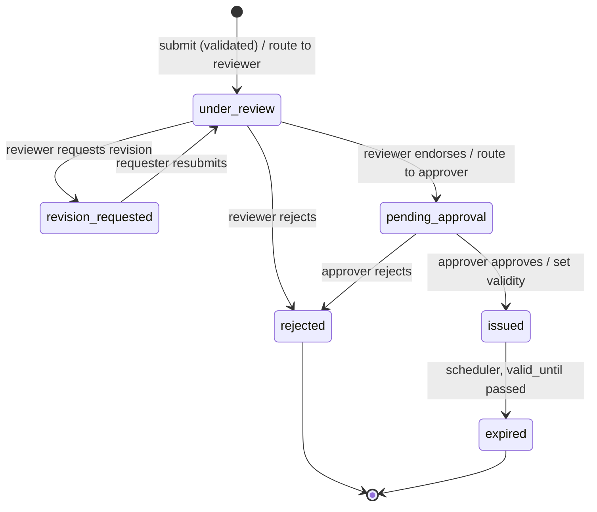
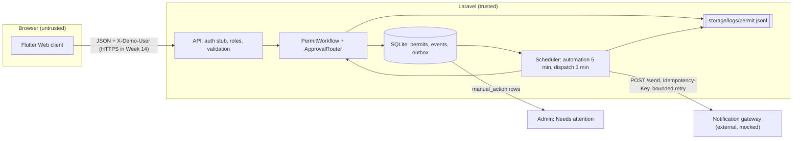
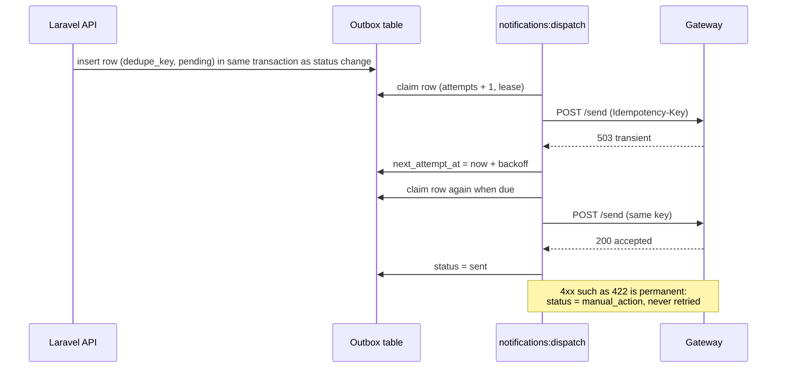

# Diagrams

Exported PNGs: `diagram-state-machine.png`, `diagram-data-flow.png`, `diagram-retry-sequence.png`. Keep the source here so the diagram can be updated when the code changes.

## Permit state machine

## Data flow and trust boundaries

## Notification retry sequence

