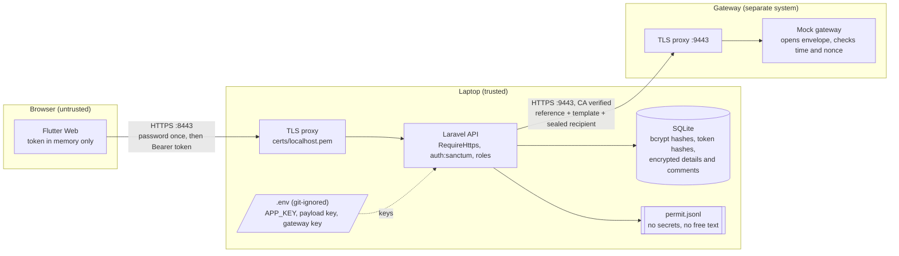

# Week 14 – Data classification, data flow and protection requirements

**Decision question:** Which permit data needs protection in transit, at rest and in logs, and which control fits each case, while collecting no more data than the workflow needs?

## Data inventory

| Data | Example (fictional) | Class | Where it lives | Needed for |
| --- | --- | --- | --- | --- |
| Password | demo password | Secret | Typed in the browser, sent once over HTTPS, stored only as a bcrypt hash | Sign-in |
| Access token | `12\|…` | Secret | Browser memory only; SHA-256 hash in `personal_access_tokens` | Every API call after sign-in |
| Email address | requester@permit.test | Personal | `users.email`; encrypted inside the gateway envelope | Sign-in, notification delivery |
| Name and role | Rico Requester, requester | Internal | `users` | Display, authorization |
| Permit purpose, location, dates | Basketball clinic, Gym A | Internal | `permits` | Review and approval |
| Permit details (free text) | contact numbers, notes | Personal (may be) | `permits.details`, **encrypted at rest** | Review |
| Reviewer comment, rejection reason | "Please attach the schedule" | Personal (may be) | `permit_events.meta`, **encrypted at rest** | Audit trail |
| Audit events, structured log | `permit.endorsed` | Internal | `permit_events`, `storage/logs/permit.jsonl` | Investigation |
| Payload key, gateway API key, APP_KEY | 32 random bytes | Secret | `backend/.env` only (git-ignored) | Encryption, gateway access |
| TLS private key | `certs/localhost-key.pem` | Secret | `certs/` only (git-ignored) | HTTPS |

**Data minimization:** the gateway receives only the permit reference, a template name and the encrypted recipient. It never receives names, purposes or free text. Browser responses still contain no emails, comments or raw errors (`PermitResource`). Retention: no automatic deletion yet (see the residual-risk register).

## Protection-requirements matrix

| Requirement | Data | Control | Evidence |
| --- | --- | --- | --- |
| Confidentiality in transit | Everything between browser, API and gateway | TLS 1.2+ through the local proxy; API refuses plain HTTP (426); gateway certificate verified against the dev CA | W07, W09 |
| Confidentiality at rest | Permit details, comments, reasons | Laravel encrypted casts (AES-256-CBC + HMAC-SHA256, key = APP_KEY) | W10, `SecurityTest` |
| Confidentiality of passwords | Passwords | bcrypt (one-way, salted, slow); never logged; same error for unknown email | W01, W02 |
| Integrity of gateway messages | Reference, template, recipient | XChaCha20-Poly1305 authentication tag over payload and associated data | W08 |
| Authenticity of the sender | Gateway messages | Only holders of the payload key can create a valid tag; bearer key on the request | W08 |
| Freshness (no replay) | Gateway messages | 5-minute timestamp window and a nonce list at the receiver | W08 |
| Authentication of users | API | Sanctum tokens, 60-minute expiry, revoked on sign-out, login throttled | W01–W06 |
| Authorization | Permit actions | Role middleware and policies (from Week 13) | W04, Week 13 S9 |
| Accountability | All state changes | Audit events and structured log with correlation IDs; no secrets or free text logged | W11 |
| Availability | Notifications | Bounded retry and manual handling (from Week 13) | W09, W12 |

## Data flow and trust boundaries

**Trust boundaries:** browser to API (untrusted client, so every rule is checked on the server) and API to gateway (another system, so the message is protected even if the transport were not).
