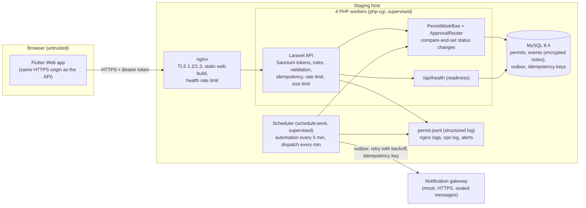

# Week 17 – Final architecture, alternatives and recommendation

Prepared by Claude Code (AI assistant) at the student's request. It summarises the decisions of Weeks 13–16; each one links to its decision record (ADR) and its evidence.

## The system as built

| Concern | Decision | Record | Evidence |
| --- | --- | --- | --- |
| What triggers automation | State changes act inside the request; time rules run on a scheduler | ADR-001 | Week 13 S1–S8 |
| Notifications | Outbox table written in the same transaction; bounded retries; permanent failures go to a person | ADR-002 | Week 13 S2–S5; Week 15 F1–F2 |
| Message protection | TLS plus a sealed, authenticated envelope to the gateway; free-text notes encrypted at rest | ADR-003 | Week 14 W07–W11 |
| Sign-in | Email and password; 60-minute bearer token held in memory | ADR-004 | Week 14 W01–W06 |
| Duplicates and races | `Idempotency-Key` on submit; compare-and-set status updates | Week 15 D3 | Week 15 F4–F5; Week 16 H2 (30/30 parallel) |
| Deployment | Release folders from one commit; nginx with PHP workers and MySQL; backup, health gate, rollback | ADR-005 | Week 16 P1–P6, F8–F9, rollback rehearsal |

## Alternatives for the final integration

Two realistic ways to run this system for the barangay were compared. The staging setup on the laptop is the prototype of the first.

| Criterion (weight) | A. One server: web app, API, scheduler and database on one Linux host (PHP-FPM, nginx, MySQL), as staging | B. Managed services: API on a platform service, managed database, web app on static hosting |
| --- | --- | --- |
| Fit for a barangay's size (3) | 5: measured capacity of about 53 requests/s on a laptop, about twice the modelled peak | 5: more than enough |
| Cost and predictability (3) | 4: one small VPS, fixed monthly cost | 2: several services, usage-based pricing, free tiers that sleep |
| Who can run it (3) | 3: needs someone who can follow the runbook and update a Linux server | 4: less server work, but provider dashboards to learn |
| Reliability and recovery (2) | 3: single machine; recovery by backup and rollback (rehearsed, about 20 s) | 4: provider-managed backups and restarts |
| Data control and privacy (2) | 4: data on a server the office chooses; easier to explain under the Data Privacy Act | 3: data spread across providers and regions; agreements needed for each |
| Matches what was tested (2) | 5: the same components measured and rehearsed in Week 16 | 2: none of it was tested |
| **Weighted total (out of 75)** | **60** | **51** |

Each score is 1–5, multiplied by the weight.

**Sensitivity:**
- **Who can run it (×5 instead of ×3):** if the office has no one at all who can look after a server, A scores 66 and B 59 (out of 85). A still wins, but only if the student or a contractor takes the maintenance role in the plan.
- **Cost (×1 instead of ×3):** A 52, B 47 (out of 65).
- **When B wins:** B overtakes A (49 to 48) only if testing evidence and data control are both ignored and reliability is weighted ×4. Choosing B would therefore mean repeating the Week 16 measurements on it and settling data-processing agreements first.

## Final recommendation

1. **Run it as option A:** one Linux server with nginx, PHP-FPM sized to its cores, MySQL, and the scheduler as a service. This is the Week 16 staging design moved from Windows scripts to standard Linux services. It removes the home-made worker supervisor and the S1 class of problem.
2. **Before any real resident data:**
   - per-user accounts and password reset
   - a privacy review with the barangay as data controller
   - a real certificate
   - alerting (`watch.sh` or a monitoring service)
   - off-machine backups
   - a real notification provider, or notifications switched off
3. **Until then, use it only for supervised trials with fictional data,** which is what the Week 16 readiness decision and the Week 17 UAT support.

Known limitations: `docs/09-known-limitations.md`. Maintenance: `46-maintenance-plan.md`.
